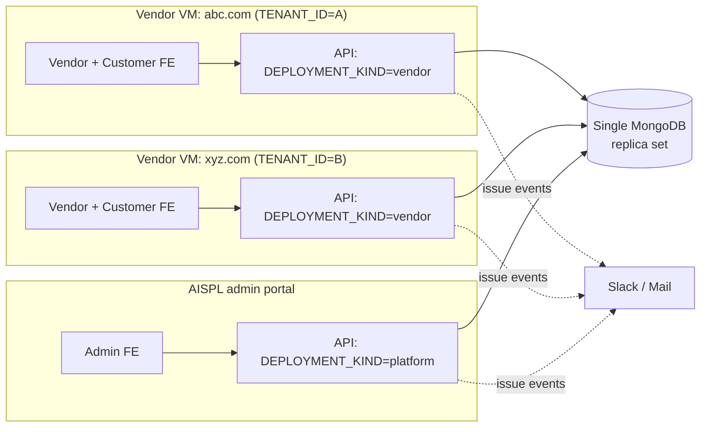
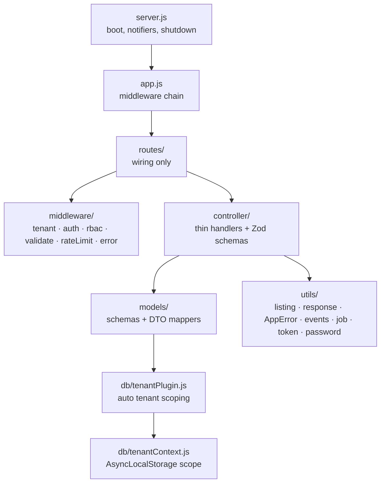
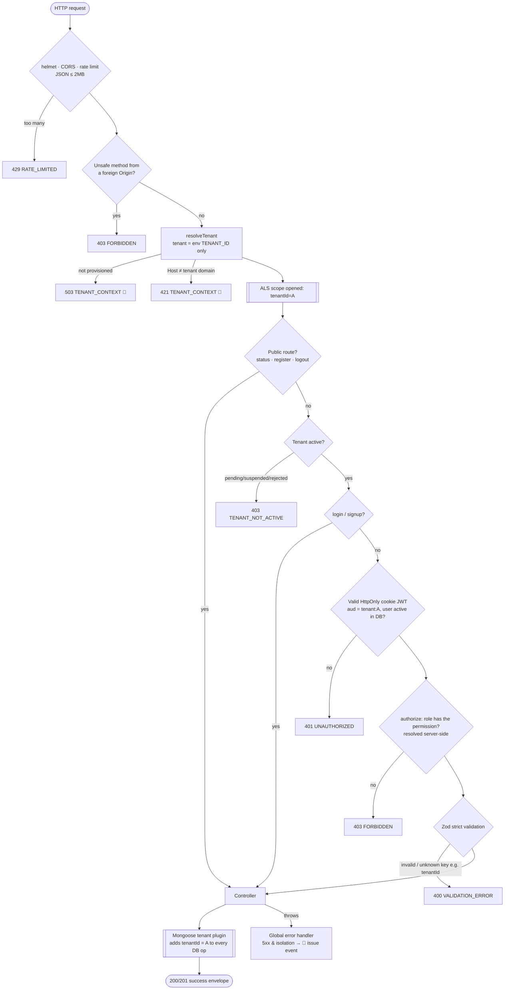
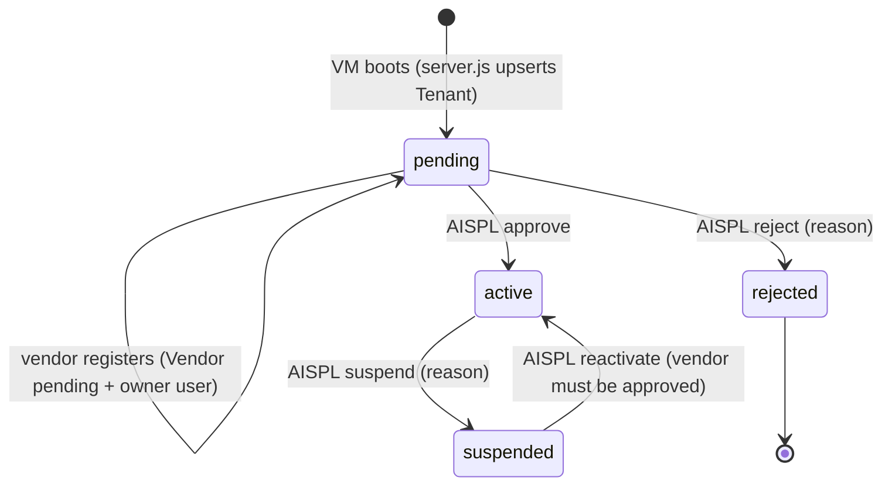
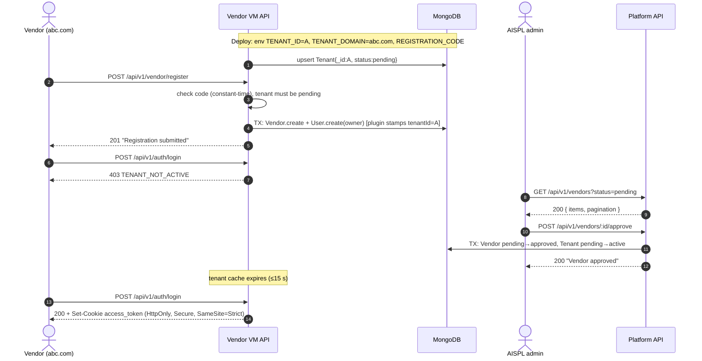
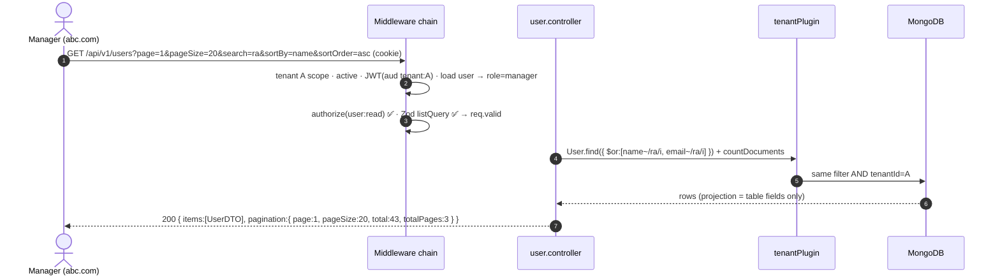
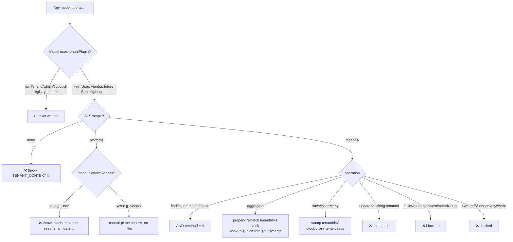
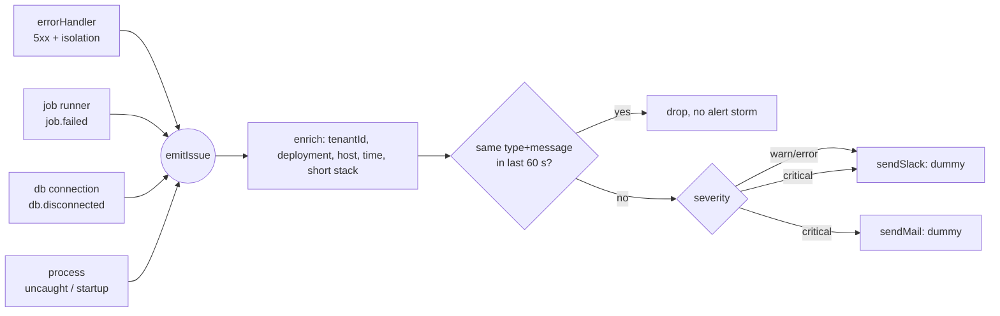
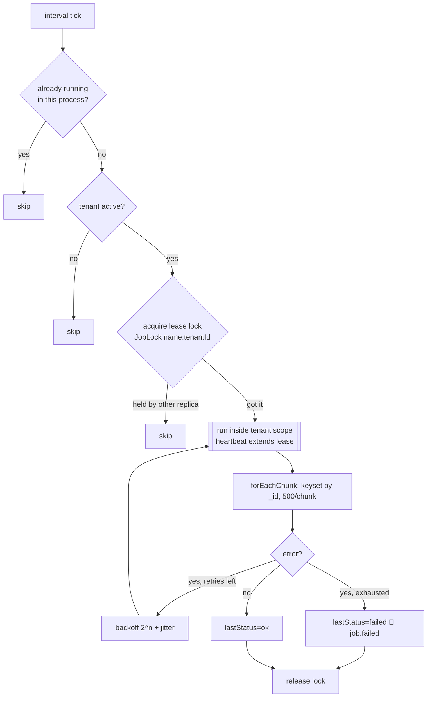

# Architecture design: multi-tenant travel CRM core

*Nilesh, 31-10-2026. This is a reference design for review. The code is in this folder; diagrams use Mermaid and render on GitHub, GitLab and VS Code.*

**Goal:** each vendor's data stays isolated and correct, and the code a developer has to write stays as small as possible.
**Idea:**
- **1 vendor = 1 VM** with a tenant pin in its env.
- **One shared MongoDB.**
- **One Mongoose plugin** scopes every query automatically, so business code never writes a `tenantId` filter.

---

## 1. Deployment view



| Layer | Who uses it | Deployment | Data it can reach |
|---|---|---|---|
| Vendor portal | owner, manager, marketing, support | vendor VM | only its own tenant |
| Customer | customers of that vendor | vendor VM (same domain) | only its own tenant |
| AISPL admin | superadmin, reviewer | platform | control plane only (Tenant, Vendor, Admin). It is **blocked** from vendor business data. |

---

## 2. Code layers



The dependency rule is that layers only point downward. Controllers never write tenant filters, and models never read `req`.

---

## 3. Request pipeline (vendor VM)

Every request passes these gates in order. The first one that fails sends its error response and the request stops there.



On the platform deployment, `resolveTenant` is replaced by `platformScope`, which opens the scope `{ platform: true }`. The rest of the chain is the same: `requireAdmin` and then `authorize(...)`.

---

## 4. Tenant lifecycle



Every move is a **compare-and-set** (`findOneAndUpdate({ status: from })`) inside a **transaction** with the Vendor update. Two admins clicking at the same time cannot both succeed, and Tenant and Vendor can never disagree.

| Tenant status | Vendor/customer APIs | Registration |
|---|---|---|
| pending | ❌ 403 TENANT_NOT_ACTIVE | ✅ once, needs `REGISTRATION_CODE` |
| active | ✅ | ❌ 409 |
| suspended | ❌ 403 | ❌ 409 |
| rejected | ❌ 403 | ❌ 409 |

---

## 5. Onboarding flow: register, then approve



**Request and response examples**

```http
POST /api/v1/vendor/register
{ "registrationCode": "…", "companyName": "ABC Travels", "contactName": "Asha",
  "email": "ops@abc.com", "phone": "+91 98765 43210",
  "owner": { "name": "Asha", "email": "asha@abc.com", "password": "••••••••••" } }

201 { "success": true, "message": "Registration submitted for AISPL approval",
      "data": { "id": "…", "tenantId": "A", "companyName": "ABC Travels", "status": "pending", … } }

403 { "success": false, "message": "Tenant is pending; access is blocked", "error": { "code": "TENANT_NOT_ACTIVE" } }
```

---

## 6. Authenticated request: list users



The search text is regex-escaped, `sortBy` must be on an allowlist, `pageSize` is at most 100, and `_id` is the tie-breaker so ordering is stable.

---

## 7. How isolation is enforced (tenant plugin)



This gives **defence in depth**:
1. Zod rejects any `tenantId` the client sends.
2. The tenant comes only from the env pin.
3. The JWT audience is bound to the tenant.
4. The plugin filters every operation and fails closed.
5. Compound indexes start with `tenantId`.

Known limits:
- `Model.collection` or the raw driver bypasses the plugin. It is forbidden by convention, so add a lint rule for it.
- Run queries with `await` *inside* the scope.

---

## 8. Error and case handling

All errors use the same envelope: `{ success:false, message, error:{ code } }`. Stack traces and internal messages never reach the client. 🔔 means an issue event is emitted.

| Case | Status | Code | 🔔 |
|---|---|---|---|
| Zod invalid body/query/params, unknown key | 400 | VALIDATION_ERROR | |
| Malformed JSON / Cast / Mongoose validation | 400 | VALIDATION_ERROR | |
| Body > 2 MB | 413 | VALIDATION_ERROR | |
| No/expired/foreign-tenant JWT, disabled user | 401 | UNAUTHORIZED | |
| Missing permission, foreign Origin, bad registration code | 403 | FORBIDDEN | |
| Tenant pending/suspended/rejected | 403 | TENANT_NOT_ACTIVE | |
| Record not in this tenant (even if the id exists elsewhere) | 404 | NOT_FOUND | |
| Duplicate (email in tenant, 2nd registration), wrong state transition | 409 | CONFLICT | |
| Host not tenant domain | 421 | TENANT_CONTEXT | ✅ critical |
| Rate limit | 429 | RATE_LIMITED | |
| Tenant row missing | 503 | TENANT_CONTEXT | ✅ critical |
| Isolation violation in code (no scope, platform→tenant data, blocked op) | 500 | TENANT_CONTEXT | ✅ critical |
| Any other unhandled error | 500 | INTERNAL_ERROR | ✅ error |
| Job failed after retries | n/a | n/a | ✅ error |
| MongoDB disconnected, uncaught exception, startup failure | n/a | n/a | ✅ critical |

---

## 9. Issue events (Slack / mail)



`emitIssue` never throws into the caller, and a notifier failure is only logged. To go live, replace the bodies of `sendSlack` and `sendMail` in `utils/events.js` with a webhook call and SES/SMTP.

---

## 10. Batch jobs



Job handlers must be **idempotent**, because a retry can run the same chunk twice. On SIGTERM the runner stops scheduling new runs and waits for in-flight ones.

---

## 11. API surface

| Deployment | Method & path | Auth / permission | Gate |
|---|---|---|---|
| vendor | GET `/tenant/status` | public | — |
| vendor | POST `/vendor/register` | registration code, rate-limited | pending only |
| vendor | POST `/auth/login` · `/auth/customer/signup` | rate-limited | active |
| vendor | POST `/auth/logout` · GET `/auth/me` | cookie | active (me) |
| vendor | GET `/vendor/me` | `vendor:read` | active |
| vendor | GET `/users` · GET `/users/:id` | `user:read` | active |
| vendor | POST `/users` · PATCH `/users/:id` | `user:write` (not owner, not self role/status) | active |
| vendor | DELETE `/users/:id` | `user:delete` (not owner, not self) | active |
| platform | POST `/auth/login` · `/auth/logout` · GET `/auth/me` | admin cookie | — |
| platform | GET `/vendors` · `/vendors/:id` | `platform:vendor:list` | — |
| platform | POST `/vendors/:id/approve` · `/reject` | `platform:vendor:review` | vendor pending |
| platform | POST `/tenants/:id/suspend` · `/reactivate` | `platform:tenant:lifecycle` | CAS on status |

**Roles and permissions** are defined once in `utils/permissions.js`. An unknown role gets no permissions.

| Role | Permissions |
|---|---|
| owner | vendor:read · user:read · user:write · user:delete |
| manager | vendor:read · user:read · user:write |
| support | vendor:read · user:read |
| marketing | vendor:read |
| customer | none (own profile via `/auth/me`) |
| superadmin | vendor list/review · tenant lifecycle |
| reviewer | vendor list/review |

---

## 12. Adding a new tenant feature (e.g. Booking)

1. `models/booking.model.js`: add `schema.plugin(tenantPlugin)` and an index starting with `{ tenantId: 1, … }`. Store money as `amountMinor` plus `currency`.
2. `controller/booking.controller.js`: write strict Zod schemas and thin handlers. Use `paginate()` for the list. Never write a `tenantId` filter.
3. `utils/permissions.js`: add the keys and map them to roles.
4. `routes/vendor.routes.js`: wire each route as `authorize(P.X), validate({...}), handler`, after `requireUser`.

Isolation, the error envelope, alerts and pagination come automatically.
